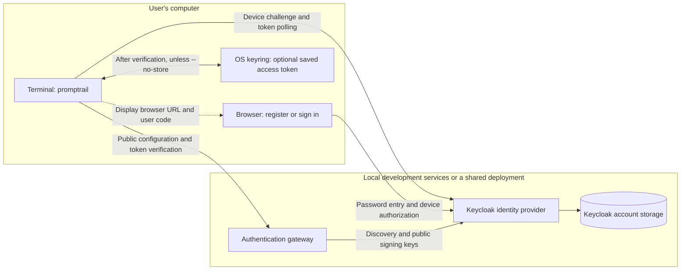
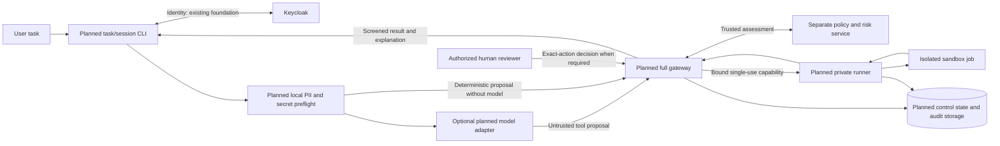

# How to run Promptrail

Promptrail is the terminal entry point for the project's security pipeline. The
long-term goal is to accept a task, check it, obtain trusted policy/risk decisions,
pause for human review when required, and run permitted tools inside a sandbox.
The terminal should explain the result and any failure in plain language.

**The current release, `0.1.0rc3`, implements the authentication foundation only.**
It connects the CLI to an authentication gateway and Keycloak so users can
register, sign in and verify their access. It does not yet accept task prompts,
call a model, score risk, request execution approval or run programs.

The future architecture below summarizes
`PROMPTRAIL_GATEWAY_PLAN.md` (maintainer-local; not included in this release). That plan remains on
hold. This guide explains its intended connections; it does not enable or
implement the planned features.

The previous gateway backend from `a4de267` is also retained under
`src/mvp/`, with its [own guide](src/mvp/README.md). It is a separate legacy
pipeline, not an additional CLI command. The authentication gateway on port 8003
does not wrap the legacy pipeline routes or connect Promptrail to its tools.
The future integration described below remains unimplemented.

## 1. What is available?

| Capability | Current behavior |
| --- | --- |
| `promptrail` / `promptrail --help` | Show commands; this is not an interactive task/chat session |
| `promptrail --version` | Show the installed release version |
| `promptrail doctor` | Check public gateway health and authentication configuration |
| `promptrail auth signup` | Start browser registration, authorize the device, then verify the resulting token with the gateway |
| `promptrail auth signin` | Sign into an existing account through the browser and verify gateway access |
| `promptrail auth status` | Ask the gateway to verify a saved credential and report identity, permissions and expiry |
| `promptrail auth signout` | Remove the selected gateway's credential from the local OS keyring |

`login` and `logout` are aliases for `signin` and `signout`. There are currently
no `run`, `eval`, `agent`, `test`, `approvals` or `audit` commands. The legacy
`jev` executable and `--verify-evaluation` option have also been removed.


## 2. What does it connect to now?



| Component | Local development address/location | Purpose |
| --- | --- | --- |
| CLI | `promptrail` in your terminal | Show login instructions and communicate with the configured services |
| Authentication gateway | `http://127.0.0.1:8003` | Publish login configuration and verify JWT identity/basic access |
| Keycloak | `http://127.0.0.1:8080/realms/promptrail` | Store user accounts, handle browser passwords and issue tokens |
| Keycloak data volume | Managed by `auth/compose.yml` | Preserve accounts across ordinary container restarts |
| OS keyring | On the CLI user's machine | Optionally store a verified token for later CLI commands |

The gateway currently exposes only `GET /health`, `GET /auth/config`,
`GET /auth/registration` and `GET /auth/whoami`. Keycloak's account storage is
separate from the future pipeline session/audit database; that runtime database
has not been implemented.

`doctor` confirms the gateway's public configuration. It does not log you in,
prove that Keycloak can complete a login, or establish that a sandbox is ready.

## 3. What do signup and signin do?

### Signup creates an account and completes a device login

Run `promptrail auth signup`. The CLI checks whether enrollment is advertised as
enabled, requests a device challenge and prints a browser URL and user code.
Open the fresh URL, choose **Register**, create your account in Keycloak and
complete device authorization. Use a private browser context when testing a new
account so an existing browser session does not silently reuse another identity.

The CLI then receives a short-lived access token and asks the gateway to verify
it. The local enrollment setup assigns only `promptrail:access`. This is basic
gateway access; it does not grant tool execution or reviewer privileges.

If enrollment is disabled, ask the administrator for an account or invitation.
The signup command cannot enable registration itself.

### Signin uses an existing account

Run `promptrail auth signin`. Open the printed URL and sign in with the account
you created. Keycloak may reuse an existing browser session. Complete the device
authorization even if the browser already recognizes you.

The CLI follows the same token-verification and optional-storage steps as signup.
Signin does not create a new account, start an agent session or approve a command.

```mermaid
sequenceDiagram
    actor U as User
    participant C as Terminal CLI
    participant G as Auth gateway
    participant I as Keycloak
    participant K as OS keyring
    C->>G: Read public login configuration
    opt Signup command
        C->>G: Check enrollment advertisement
    end
    C->>I: Request device challenge using public client ID
    I-->>C: Browser URL, user code, private device code
    C-->>U: Display URL and user code; wait
    alt New account via signup
        U->>I: Choose Register and create account in browser
    else Existing account via signin
        U->>I: Sign in through browser
    end
    U->>I: Authorize this device request
    loop Until authorized, denied or expired
        C->>I: Poll using private device code
        I-->>C: Pending status or short-lived access token
    end
    C->>G: Send token to /auth/whoami
    G->>I: Obtain public signing keys when needed
    G->>G: Verify signature, issuer, audience, client, expiry and permission
    G-->>C: Verified identity or safe failure
    alt Verification passed and storage enabled
        C->>K: Save token for selected gateway URL
    else Verification passed with --no-store
        C-->>U: Report success without saving credential
    end
```

Passwords go only into the identity provider's browser page. The CLI does not
collect or store them. The gateway verifies RS256 JWT signatures and requires
both a requested scope and an assigned signed role for `promptrail:access`.
Browser success alone is insufficient if gateway verification fails.

### How the current user session is maintained

The local access token lasts five minutes; device codes last ten minutes.
A new CLI command can reuse a valid token saved in the OS keyring, scoped to the
selected gateway URL. `auth status` verifies it with the gateway again rather
than trusting locally decoded JWT text.

With `--no-store`, login is verified for that process only. After the command
ends, another CLI process has no newly saved credential. This is the recommended
verification path on a headless host without a working secure keyring.

There is no refresh-token storage or automatic renewal. Sign in again after
expiry. `signout` deletes the local keyring credential; it does not revoke every
issued JWT, delete the account or clear the browser's SSO session. If you set
`PROMPTRAIL_AUTH_TOKEN` yourself, unset it separately because it overrides keyring
lookup. Access tokens should not be copied into `.env` files or shared in chat.

User authentication and future task/agent sessions are different: a valid JWT
identifies the caller, while planned task state will track proposals, reviews and
jobs. No task/agent session implementation is included in this release.

## 4. Run the CLI against your existing local services

Use this path if the current gateway and Keycloak are already running. Otherwise
complete Section 5 first. Commands assume you are in the project root.

### Install the local terminal package

Use Python 3.11+ and pipx. The locally built artifact is:

```bash
pipx install ./dist/promptrail_cli-0.1.0rc3-py3-none-any.whl
hash -r
promptrail --version
promptrail --help
```

If replacing an installed rc2/rc3 distribution, first run
`pipx uninstall promptrail-cli`, then install the local wheel above. An older
`jev-security-cli` installation instead needs `pipx uninstall jev-security-cli`.
These remove the installed application, not your Keycloak account. Public release
hosting is not established by this guide; use the wheel built from the checkout
or supplied by the team. Section 5 shows how to build it if `dist/` is absent.

### Check connectivity and sign in

```bash
export PROMPTRAIL_GATEWAY_URL=http://127.0.0.1:8003
promptrail doctor
promptrail auth signin --no-store
```

For your first account, use this instead of signin:

```bash
promptrail auth signup --no-store
```

Open the URL printed by that invocation and complete the browser steps. Do not
reuse an old device URL from documentation, a screenshot or a previous login.
Successful verification includes:

```text
Login verified by the gateway.
Credential was not stored.
Permissions: promptrail:access
```

Check the expected no-store result:

```bash
promptrail auth status --json
```

If no earlier credential or environment override exists, expect
`{"authenticated": false, "reason_code": "NO_CREDENTIAL"}` and exit code 1.
That is expected after `--no-store`; it does not mean the previous login failed.

### Test persistent login on a machine with a secure keyring

```bash
promptrail auth signin
promptrail auth status
promptrail auth signout
promptrail auth status
```

Before expiry, the first status should report a verified identity; the last
should report `NO_CREDENTIAL` if no environment override exists. If signin reports
`SECURE_KEYRING_UNAVAILABLE`, use `--no-store`; do not save the token to a plaintext
file to work around it.

## 5. Start a fresh local development environment

This path runs the services on your own machine. Docker Compose v2 is required
for Keycloak. The gateway runs in a Python virtual environment. If ports 8080 or
8003 already belong to an existing test environment, reuse it or stop that known
environment before starting another instance.

In terminal A, from the project root:

```bash
python3 -m venv .venv
.venv/bin/python -m pip install -e './cli[test]' -r auth/requirements.txt
.venv/bin/python auth/setup.py

docker compose --env-file auth/.env -f auth/compose.yml up -d
```

`setup.py` creates a private `auth/.env` for server settings and a generated
Keycloak bootstrap-administrator password. It preserves existing values. No
model API key is needed for the current release. The local administrator is
`promptrail-admin`; normal CLI users create their own accounts.

Wait for Keycloak to finish startup. This public check should return successfully;
if it fails during initial import, retry after startup finishes:

```bash
curl --fail --silent --show-error \
  http://127.0.0.1:8080/realms/promptrail/.well-known/openid-configuration \
  --output /dev/null
```

To allow users to register in this local test environment, the administrator runs:

```bash
.venv/bin/python auth/setup.py --enable-signup
```

Then start the gateway and leave terminal A running:

```bash
.venv/bin/python -m uvicorn auth.gateway:app --host 127.0.0.1 --port 8003 --env-file auth/.env
```

In terminal B, use the development installation directly:

```bash
source .venv/bin/activate
export PROMPTRAIL_GATEWAY_URL=http://127.0.0.1:8003
promptrail --version
promptrail doctor
promptrail auth signup --no-store
```

If you already have an account in this realm, use `auth signin --no-store`.
Earlier accounts in the separate `jev` realm were not automatically migrated.

To build the wheel for installation with pipx:

```bash
.venv/bin/python -m pip wheel --no-deps --wheel-dir dist ./cli
```

To stop your local services, press Ctrl+C in the gateway terminal and run:

```bash
docker compose --env-file auth/.env -f auth/compose.yml down
```

Ordinary `down` preserves the named Keycloak data volume. Do not add `--volumes`
if accounts must survive. The supplied configuration is development-only; the
production deployment location and host choice remain undecided in the plan.

## 6. Connect a teammate's CLI to shared services

A teammate needs the terminal package, their own identity account and a reachable
gateway URL supplied by the operator. They do not need to install the server
folder or run Docker when using a shared deployment.

For example, replace the illustrative hostname with the actual team gateway:

```bash
export PROMPTRAIL_GATEWAY_URL=https://gateway.example.edu
promptrail doctor
promptrail auth signin --no-store
```

A teammate's `127.0.0.1` means their own computer. It cannot point to services on
your laptop unless a deliberate local tunnel is configured. The gateway's
advertised Keycloak issuer must also be reachable from the teammate's machine
and browser. Shared deployment needs HTTPS for both services; remote HTTP
addresses are rejected. Installing a wheel does not start either service.

## 7. What will it connect to when the plan resumes?

**Everything marked planned in this section is future work.** The current CLI
cannot run the task flow below, and this guide adds no such implementation.



| Planned connection | Responsibility | What the CLI does |
| --- | --- | --- |
| Model provider | Propose bounded tasks/tool arguments when needed; Ollama primary and optional OpenAI fallback are planned | Send permitted content through a future model adapter; treat the answer as untrusted |
| Policy/risk service, potentially Jev as an external provider | Own scoring, attack categories, policy mapping and approved sanitization | Submit requests through the gateway; never fabricate an authoritative ALLOW |
| Expanded gateway | Enforce identity, trusted assessment, tool schema/scope, exact approval and dispatch constraints | Send authenticated proposals and display their state |
| Reviewer workflow | Inspect the exact action and approve/reject only where policy permits review | Pause and retain context; signin alone never constitutes approval |
| Private runner and sandbox | Validate a bound execution capability and execute a constrained job | Obtain results through the gateway, without local unrestricted shell execution |
| Control/audit database and explanation API | Track sessions/actions/jobs, preserve secret-safe evidence and explain failures | Use authorized APIs; carry no direct database credentials |

The proposed policy actions are `ALLOW`, `SANITIZE`, `REQUIRE_APPROVAL`,
`QUARANTINE` and `BLOCK`. Proposed risk classifications are `BENIGN`,
`INSTRUCTION_OVERRIDE`, `DATA_EXFILTRATION`, `TOOL_COERCION` and `OBFUSCATION`.
The policy/risk component owns their scores and mapping. The gateway enforces
the returned decision plus its independent execution constraints.

For a future task such as “write and run a Python Fibonacci program,” the planned
sequence is: local preflight, proposal, trusted assessment, any exact-action
review, constrained sandbox execution, output screening, and a human-readable
result with correlated audit evidence. A block/quarantine or missing prerequisite
stops dispatch; no program is run merely because login succeeded. The planned
session lifecycle will save review/recovery context without saving bearer tokens,
and an unknown execution outcome must be reconciled before a retry.

See the plan's Sections 2–4 for component ownership, policy and session behavior;
Sections 5–6 for logging/error explanations; and Sections 8 and 12 for real-execution
acceptance and implementation gates. Future diagrams are design targets, not
current readiness evidence.

## 8. Common results and what to do

| Result | Meaning | Next action |
| --- | --- | --- |
| `command not found: promptrail` | CLI not installed or its executable directory is not on PATH | Install the wheel and configure pipx's PATH; reopen the terminal if needed |
| `doctor` cannot reach the gateway | Wrong address or stopped/unreachable service | Check `PROMPTRAIL_GATEWAY_URL` and the gateway process |
| `SIGNUP_UNAVAILABLE` | Enrollment is not advertised as enabled | Ask the operator for access; local administrators can use the enrollment setup command |
| `SECURE_KEYRING_UNAVAILABLE` | Requested persistent storage is unavailable | Rerun with `--no-store` for verification |
| `NO_CREDENTIAL` after no-store login | No newly saved token for the next process | Expected; use persistent signin only on a supported keyring |
| `DEVICE_CODE_EXPIRED` or an invalid browser code | The old device challenge is no longer usable | Rerun signup/signin and use only its new URL/code |
| `TOKEN_EXPIRED` | Saved access token has expired | Sign in again |
| `INSUFFICIENT_PERMISSION` | The verified account lacks required assigned/requested access | Ask the administrator to check the account's access; requesting more scope does not grant it |

On first installation, `pipx ensurepath` can help expose its executable directory.
When reporting a problem, include CLI version, command, safe reason code and
expected/actual behavior. Exclude passwords, keys, tokens and private `.env` data.

For code/file/function details, use [cli/README.md](cli/README.md) and
[auth/README.md](auth/README.md). For the current component overview, use
[CLI_README.md](CLI_README.md). For future architecture and work tracking, use
the maintainer-local `PROMPTRAIL_GATEWAY_PLAN.md` (not distributed in this release).
